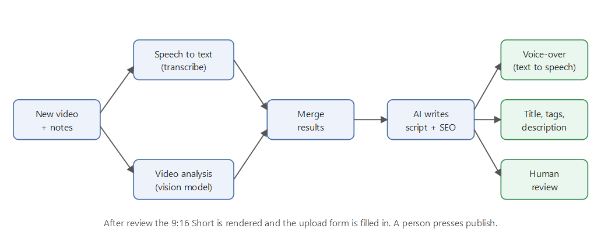

# Shorts pipeline (showcase)

An automation built with n8n that turns videos into ready-to-review YouTube Shorts: it understands the video, writes the script and SEO text, adds a voice-over, and leaves the final publish decision to a person.

This repository is a **description only**. No code, workflow files or configuration are published.

## How it works

1. **Intake.** A new video with a few notes starts the n8n workflow.
2. **Understanding, in parallel.** One branch turns the speech into text, the other describes what happens on screen with a vision model.
3. **Merge and write.** Both results are combined and an AI model writes the script, title, description and tags.
4. **Voice-over.** The script is turned into audio with a text-to-speech model.
5. **Review.** Video, audio and texts are collected in one place for a human check.
6. **Render and publish.** The vertical 1080x1920 Short is rendered and the upload form is filled in. **A person always presses publish.**

## Build your own

- **Server.** Rent a small virtual server from any hosting provider and install n8n on it (Docker is the easiest way).
- **AI models.** Connect the models you prefer. Assistants such as Claude or Gemini can write titles, descriptions and scripts, and image models can create thumbnails.
- **Credentials.** Keep every key inside n8n's credential store, never in exported workflow files.
- **Rendering.** Any video tool that can cut to 9:16 and mix audio works for the final step.

## Design choices

- **Human in the loop.** Nothing is published automatically, which keeps quality high and respects platform rules on repetitive or inauthentic content.
- **Parallel branches** shorten the run time; the merge step gives the writing model the full picture.
- **Replaceable parts.** Each stage (speech to text, vision, writing, voice) can be swapped without touching the others.

## Status

Working end to end for personal use.
